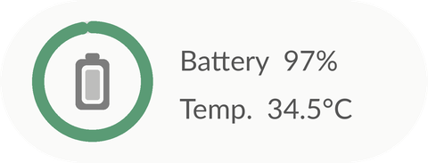

# RAM & ROM Widget

[Tiếng Việt](README.md) · **English**

Home-screen widgets for Android that show RAM, internal storage, battery and device information in real time.
Written in plain Java with no third-party dependencies. No root and no Internet permission required.

## Features

- 8 widget styles in several sizes (2×1, 2×2, 4×2).
- Refreshes about every 3 seconds while the screen is on and stops completely when it is off.
- In-app preview of every widget using the device's live data.
- Adjustable background transparency (0–100%) and a Liquid Glass effect for all widgets.
- RAM cleanup from the app and from the 4×2 widget.
- Material You colors, light/dark theme, English and Vietnamese.

## Requirements

Android 12 or later (API 31+).

## Widgets

| Widget | Size | Content |
|---|---|---|
| Device info | 4×2 | Clock, date, RAM, storage, battery (voltage, temperature) |
| Terminal | 4×2 | Device name, Android version, chip, battery, storage |
| RAM | 2×1 | RAM usage ratio and amount used |
| Internal storage | 2×1 | Usage ratio and free space |
| Battery | 2×1 | Level, temperature, charging state |
| RAM details | 2×2 | Gauge, usage ratio, total and available |
| RAM & ROM | 2×2 | Two usage rings for storage and RAM |
| RAM & ROM | 4×2 | Two progress bars and a RAM cleanup button |

<p>
  
  
</p>
<p>
  
  
  
  
</p>

## Installation

Download `app-release.apk` from [Releases](../../releases) and install it on the device. Launch the app once after installation to start the widget update service.

Widgets can be added from the *Home screen widgets* section in the app or from the launcher's widget picker.

## Notes

- **Background updates:** some vendors (Xiaomi, Oppo, Samsung…) restrict background services. Setting the app's battery usage to *Unrestricted* keeps widgets updating reliably.
- **Service notification:** Android requires a notification for foreground services. It uses the lowest importance: silent, with no status-bar icon.
- **Liquid Glass:** launchers do not allow widgets to blur the wallpaper, so the effect is simulated with gradients and highlights.
- **RAM cleanup:** Android manages memory itself and a non-root app can only stop other apps' background processes, so the amount freed may be small.
- **Chip names:** chip codes are mapped to marketing names (Snapdragon, Exynos, Dimensity, Tensor) in `DeviceInfo.java`. Unlisted chips show the raw code.

## Permissions and privacy

| Permission | Purpose |
|---|---|
| `KILL_BACKGROUND_PROCESSES` | Stop background processes during RAM cleanup |
| `FOREGROUND_SERVICE`, `FOREGROUND_SERVICE_SPECIAL_USE` | Real-time widget updates while the screen is on |
| `RECEIVE_BOOT_COMPLETED` | Restart the service after reboot or app update |
| `queries` (launcher / home) | List apps to stop without broad package visibility |

The app has no Internet permission. All data is read and processed on the device.

## Building from source

Requires JDK 17+ and the Android SDK (platform 35). Set the SDK path via `ANDROID_HOME` or `local.properties`.

```bash
./gradlew assembleRelease
```

The APK is written to `app/build/outputs/apk/release/app-release.apk`.

### Signing

The `release` build uses the first signing key available:

1. `keystore.properties` and `release.jks` in the project root (keys `storeFile`, `storePassword`, `keyAlias`, `keyPassword`).
2. `release.keystore` restored by CI from a secret, with passwords from `KEYSTORE_PASSWORD`, `KEY_ALIAS`, `KEY_PASSWORD`.
3. The debug key otherwise.

Key files are excluded via `.gitignore`.

### CI

`.github/workflows/build.yml` builds the APK on every push to `main` and on pull requests. Pushing a `v*` tag publishes the APK to Releases.
To sign CI builds, configure the `KEYSTORE_BASE64`, `KEYSTORE_PASSWORD`, `KEY_ALIAS` and `KEY_PASSWORD` secrets.

## Project structure

```
app/src/main/java/com/vdd/memwidget/
  MainActivity.java        Main screen, RAM/ROM details, widget gallery
  WidgetStyle.java         Background transparency and glass effect
  WidgetKinds.java         Widget type and size definitions
  WidgetViews.java         RemoteViews construction for each widget
  WidgetUpdater.java       Pushes updates when data, size or style changes
  MonitorService.java      Background updater, runs only while the screen is on
  Gauges.java              Ring and arc rendering
  MemStats.java, BatteryInfo.java, DeviceInfo.java, Snapshot.java   System metrics
  MemCleaner.java          RAM cleanup
  *WidgetProvider.java     One provider per widget
app/src/main/res/          Layouts, colors, strings (values: English, values-vi: Vietnamese), previews
```

## Contributing

Issues and pull requests are welcome, especially new widget styles, additional chip names and translations (`values-xx/strings.xml`).

## Author

Vũ Đình Đạt · [@Vudinhdat02](https://github.com/Vudinhdat02)
