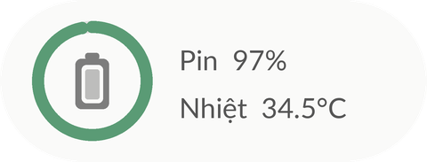

# RAM & ROM Widget

**Tiếng Việt** · [English](README.en.md)

Bộ widget màn hình chính cho Android, hiển thị RAM, bộ nhớ trong, pin và thông tin thiết bị theo thời gian thực.
Viết bằng Java thuần, không phụ thuộc thư viện bên thứ ba, không yêu cầu root và không dùng quyền Internet.

## Tính năng

- 8 mẫu widget với nhiều kích thước (2×1, 2×2, 4×2).
- Cập nhật khoảng 3 giây một lần khi màn hình bật, dừng hoàn toàn khi màn hình tắt.
- Xem trước từng widget ngay trong ứng dụng với số liệu thực của thiết bị.
- Tùy chỉnh độ trong suốt nền (0–100%) và hiệu ứng Liquid Glass cho toàn bộ widget.
- Chức năng giải phóng RAM trong ứng dụng và trên widget 4×2.
- Hỗ trợ Material You, giao diện sáng/tối, tiếng Việt và tiếng Anh.

## Yêu cầu

Android 12 trở lên (API 31+).

## Danh sách widget

| Widget | Kích thước | Nội dung |
|---|---|---|
| Thông tin thiết bị | 4×2 | Đồng hồ, ngày, RAM, bộ nhớ trong, pin (điện áp, nhiệt độ) |
| Terminal | 4×2 | Tên máy, phiên bản Android, chip, pin, dung lượng lưu trữ |
| RAM | 2×1 | Tỷ lệ và dung lượng RAM đã dùng |
| Bộ nhớ trong | 2×1 | Tỷ lệ sử dụng và dung lượng còn trống |
| Pin | 2×1 | Mức pin, nhiệt độ, trạng thái sạc |
| RAM chi tiết | 2×2 | Đồng hồ đo, tỷ lệ sử dụng, tổng và còn trống |
| RAM & ROM | 2×2 | Hai vòng tỷ lệ cho bộ nhớ trong và RAM |
| RAM & ROM | 4×2 | Hai thanh tiến trình và nút giải phóng RAM |

<p>
  
  
</p>
<p>
  
  
  
  
</p>

## Cài đặt

Tải `app-release.apk` từ trang [Releases](../../releases) và cài đặt trên thiết bị. Sau khi cài, mở ứng dụng một lần để khởi động dịch vụ cập nhật widget.

Widget có thể được thêm từ mục *Widget màn hình chính* trong ứng dụng hoặc từ danh sách widget của launcher.

## Lưu ý

- **Cập nhật nền:** một số hãng (Xiaomi, Oppo, Samsung…) hạn chế dịch vụ nền. Nên đặt mức sử dụng pin của ứng dụng là *Không hạn chế* để widget cập nhật ổn định.
- **Thông báo dịch vụ:** Android yêu cầu dịch vụ nền có thông báo. Thông báo được đặt ở mức ưu tiên thấp nhất, không âm thanh, không hiện biểu tượng trên thanh trạng thái.
- **Liquid Glass:** launcher không cho phép widget làm mờ hình nền, nên hiệu ứng được mô phỏng bằng gradient và viền sáng.
- **Giải phóng RAM:** Android tự quản lý bộ nhớ và ứng dụng không có root chỉ dừng được tiến trình nền của ứng dụng khác, nên lượng RAM giải phóng có thể nhỏ.
- **Tên chip:** mã chip được ánh xạ sang tên thương mại (Snapdragon, Exynos, Dimensity, Tensor) trong `DeviceInfo.java`. Chip chưa có trong bảng sẽ hiển thị mã gốc.

## Quyền và quyền riêng tư

| Quyền | Mục đích |
|---|---|
| `KILL_BACKGROUND_PROCESSES` | Dừng tiến trình nền khi giải phóng RAM |
| `FOREGROUND_SERVICE`, `FOREGROUND_SERVICE_SPECIAL_USE` | Cập nhật widget theo thời gian thực khi màn hình bật |
| `RECEIVE_BOOT_COMPLETED` | Khởi động lại dịch vụ sau khi khởi động máy hoặc cập nhật ứng dụng |
| `queries` (launcher / home) | Liệt kê ứng dụng cần dừng mà không cần quyền xem toàn bộ gói |

Ứng dụng không có quyền Internet. Mọi dữ liệu được đọc và xử lý trên thiết bị.

## Build từ mã nguồn

Yêu cầu JDK 17+ và Android SDK (platform 35). Đường dẫn SDK được khai báo qua `ANDROID_HOME` hoặc `local.properties`.

```bash
./gradlew assembleRelease
```

APK được tạo tại `app/build/outputs/apk/release/app-release.apk`.

### Ký ứng dụng

Thứ tự khóa ký được dùng cho bản `release`:

1. `keystore.properties` và `release.jks` ở thư mục gốc (các khóa `storeFile`, `storePassword`, `keyAlias`, `keyPassword`).
2. `release.keystore` do CI tạo từ secret, với mật khẩu lấy từ biến môi trường `KEYSTORE_PASSWORD`, `KEY_ALIAS`, `KEY_PASSWORD`.
3. Khóa debug nếu không có hai lựa chọn trên.

Các file khóa đã được loại trừ trong `.gitignore`.

### CI

Workflow `.github/workflows/build.yml` build APK cho mỗi lần push lên `main` và mỗi pull request. Khi push tag dạng `v*`, APK được đăng lên Releases.
Để ký bản build CI, cấu hình các secret `KEYSTORE_BASE64`, `KEYSTORE_PASSWORD`, `KEY_ALIAS`, `KEY_PASSWORD`.

## Cấu trúc mã nguồn

```
app/src/main/java/com/vdd/memwidget/
  MainActivity.java        Màn hình chính, chi tiết RAM/ROM, thư viện widget
  WidgetStyle.java         Độ trong suốt và hiệu ứng kính cho nền widget
  WidgetKinds.java         Định nghĩa các loại widget và kích thước
  WidgetViews.java         Dựng RemoteViews cho từng widget
  WidgetUpdater.java       Cập nhật widget khi dữ liệu, kích thước hoặc giao diện thay đổi
  MonitorService.java      Dịch vụ cập nhật nền, chỉ chạy khi màn hình bật
  Gauges.java              Vẽ vòng và cung đo
  MemStats.java, BatteryInfo.java, DeviceInfo.java, Snapshot.java   Thu thập số liệu hệ thống
  MemCleaner.java          Giải phóng RAM
  *WidgetProvider.java     Provider cho từng widget
app/src/main/res/          Layout, màu, chuỗi (values: English, values-vi: Tiếng Việt), ảnh xem trước
```

## Đóng góp

Issue và pull request đều được hoan nghênh, đặc biệt là mẫu widget mới, bổ sung tên chip và bản dịch (`values-xx/strings.xml`).

## Tác giả

Vũ Đình Đạt · [@Vudinhdat02](https://github.com/Vudinhdat02)
